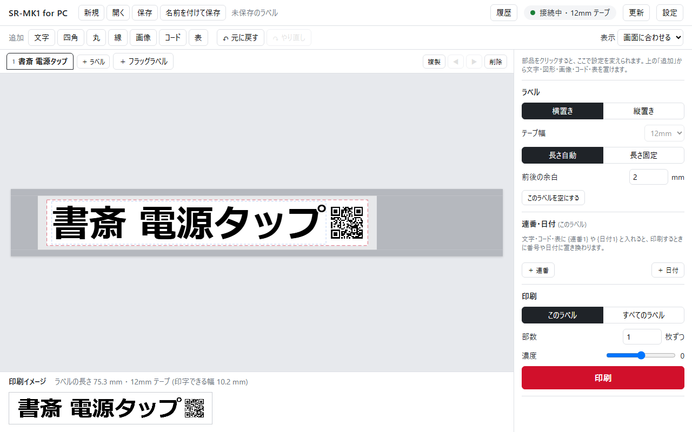
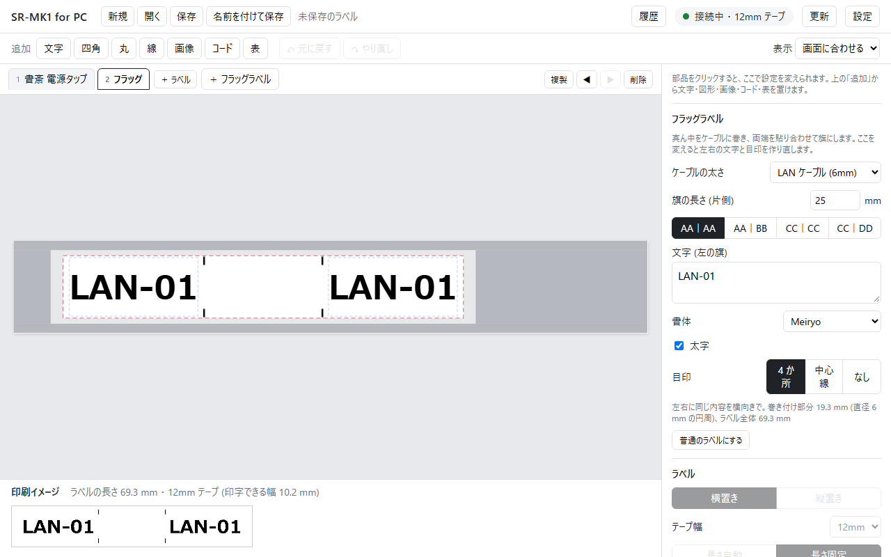
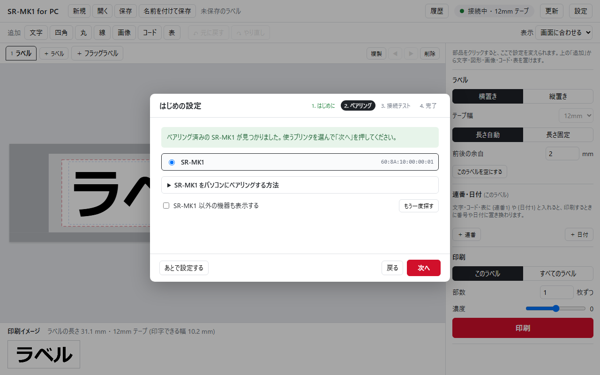

# SR-MK1 for PC

**テプラ PRO SR-MK1 を、Windows パソコンから使えるようにするラベル作成アプリです（非公式）。**

SR-MK1 は本来スマホ専用のラベルプリンタで、パソコン用のソフト「テプラ クリエイター」には対応していません。
このアプリを入れると、Windows パソコンから Bluetooth で SR-MK1 に直接つないで、ラベルを作って印刷できます。
「パソコンで使いたいから SR-MK2 に買い替えようかな…」と考えている方は、その前にぜひ試してみてください。



> [!IMPORTANT]
> 個人が作った**非公式**のアプリです。株式会社キングジムとは関係がなく、キングジムに問い合わせることはできません。
> 動作は保証できません。ご自分の判断でお使いください（[できないこと・注意](docs/limitations.md)）。

## ダウンロード

**[最新版のダウンロードページ（Releases）](../../releases/latest)** から、どちらかをダウンロードしてください。

| ファイル | こんな方に |
|---|---|
| `SR-MK1-for-PC-<版>-setup.exe` | **ふつうはこちら。** ダブルクリックでインストールでき、スタートメニューから起動できます |
| `SR-MK1-for-PC-<版>-portable.zip` | インストールしたくない方。展開して、中の `SR-MK1 for PC.exe` を起動します |

初めての方は **[はじめかた](docs/getting-started.md)** を見ながら進めると、10 分ほどで最初のラベルを印刷できます。
ダウンロードやインストールのときに Windows の警告が出たときの進め方も、そこに書いてあります。

## 必要なもの

- **テプラ PRO SR-MK1**
- **Windows 10（バージョン 1809 以降）または Windows 11**（64 ビット）
- **パソコンの Bluetooth**。ノートパソコンの多くには内蔵されています。
  Bluetooth のないパソコンでは、USB の Bluetooth アダプタを使えます（TP-Link UB400 で動作を確認）
- Python などのインストールは**不要**です

## できること

- **自由なレイアウト**: 文字・四角・丸・線・画像・表・QR コード・バーコードを置いて、動かす・回転・揃え・グループ化
- **文字**: パソコンに入っている書体、太字・斜体・下線、縁取りや白抜き、縦書き、テープ幅に合わせた自動サイズ
- **QR コード・バーコード**: QR コード、JAN、CODE128、CODE39、ITF、NW-7、GS1 データバー、郵便のカスタマバーコードなど
- **連番・日付**: `No.001`, `No.002`… のような番号や、今日の日付を自動で入れて連続印刷
- **フラッグラベル**: ケーブルに巻いて旗のようにするラベルを、太さを選ぶだけで作れます
- **複数のラベル**をタブでまとめて作り、まとめて印刷（1 枚ずつカット）
- 作ったラベルの**保存・読み込み**、**印刷履歴**からもう一度印刷
- テープの幅を**プリンタから自動で読み取り**
- 途中で止まった印刷（テープ切れなど）を**続きから印刷**
- 機械ごとの長さのずれを直す**寸法の補正**

くわしくは **[使い方](docs/usage.md)** をご覧ください。

<p>
  
  
</p>

## 使えるテープ

| テープ幅 | 状態 |
|---|---|
| 12mm、24mm | 実機で確認済み |
| 4mm、6mm、9mm、18mm | 使えるはずですが、まだ実機で確かめていません |
| ケーブル表示ラベル用テープ | 使えません（アプリが「未対応」と表示します） |

## 困ったときは

**[困ったとき（よくある質問）](docs/faq.md)** をご覧ください。
それでも解決しないときは、このページの「Issues」から知らせてください。
アプリの「設定」→「困ったとき」にある **「診断情報をコピー」** の内容を貼り付けていただけると、原因を探しやすくなります。

## ドキュメント

- [はじめかた](docs/getting-started.md) — ダウンロード、インストール、ペアリング、最初の印刷
- [使い方](docs/usage.md) — ラベルの作り方、連番・日付、フラッグラベル、保存と履歴、寸法の補正
- [困ったとき](docs/faq.md) — つながらない、警告が出る、印刷が止まった など
- [できないこと・注意](docs/limitations.md)

## 商標・お断り

- 「テプラ」「TEPRA」は株式会社キングジムの登録商標です。その他の会社名・製品名は、各社の商標または登録商標です。
- このアプリは、株式会社キングジムが作ったり、認めたりしたものではありません。
- このアプリを使ったことで起きた不具合や損害（プリンタやテープを含む）について、作者は責任を負いません。

## 謝辞

プリンタとの通信の仕組みは、次の公開資料を参考にしました。

- [nikachu2012/tepra_web](https://github.com/nikachu2012/tepra_web)
- [takustaqu/labelbridge](https://github.com/takustaqu/labelbridge)

## ライセンス

- このアプリ: [MIT License](LICENSE.txt)
- 同梱しているソフトウェア（Fabric.js、bwip-js、pywebview、Pillow、Python など）: [THIRD_PARTY_NOTICES.txt](THIRD_PARTY_NOTICES.txt)

## 開発者の方へ

Python 3.11 と、Bluetooth Classic（RFCOMM）が使える Windows で動かせます。

```powershell
python -m venv .venv
.venv\Scripts\pip install -r requirements.txt
.venv\Scripts\python app\main.py            # アプリを起動 (--debug で開発者ツール)
.venv\Scripts\python cli.py status          # コマンドラインでプリンタの状態を見る
```

- 通信の仕組みと実機で確かめたこと: [NOTES.md](NOTES.md)
- 配布ファイルを作る: `.venv\Scripts\pip install pyinstaller` と Inno Setup 6 を入れてから
  `powershell -ExecutionPolicy Bypass -File packaging\build.ps1`
- 画面だけをブラウザで確かめる: `python -m http.server 8765 --directory app/web` → `http://localhost:8765/?mock`

| フォルダ | 中身 |
|---|---|
| `tepra/` | プリンタとの通信（コマンド・ステータス・ラスター化） |
| `app/` | アプリ（pywebview）。`app/web/` が画面（HTML / JavaScript） |
| `packaging/` | exe・インストーラー・zip を作るための設定 |
| `docs/` | 利用者向けのマニュアル |
