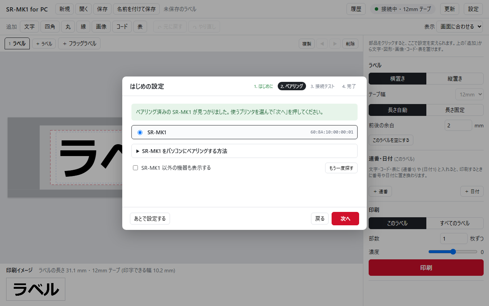

# はじめかた

ダウンロードから最初のラベルを印刷するまでの手順です。10 分ほどかかります。

[← README に戻る](../README.md)

---

## 1. 用意するもの

- テプラ PRO SR-MK1（電源を入れ、テープカートリッジを入れておく）
- Windows 10 または 11 のパソコン（Bluetooth があるもの。ない場合は USB の Bluetooth アダプタ）

> [!TIP]
> スマホのアプリで SR-MK1 を使っている場合は、作業の間だけ**スマホの Bluetooth をオフ**にしてください。
> SR-MK1 は同時に 1 台としかつながらないので、スマホとつながったままだとパソコンからつながりません。

## 2. ダウンロード

[README の「ダウンロード」](../README.md#ダウンロード) にあるリンクから、最新版のページを開きます。
「Assets」の中の **`SR-MK1-for-PC-<版>-setup.exe`** を押してダウンロードしてください。

> [!NOTE]
> **ブラウザが「一般的にダウンロードされていません」などと警告する場合**
>
> このアプリはまだ利用者が少なく、電子署名もしていないため、ブラウザが注意を出すことがあります。
> Microsoft Edge では、警告の右にある「…」→「保存」→「詳細表示」→「保持する」の順に押すと、ダウンロードできます。

## 3. インストール

ダウンロードした `SR-MK1-for-PC-<版>-setup.exe` をダブルクリックします。

> [!NOTE]
> **青い画面「Windows によって PC が保護されました」が出た場合**
>
> 電子署名のないアプリでは、Windows がこの画面を出します。
> 画面の **「詳細情報」** を押すと出てくる **「実行」** を押してください。

インストーラーの画面にしたがって「次へ」を押していけば、インストールできます。

- パスワードの入力など、管理者の確認は必要ありません
- 「デスクトップ上にアイコンを作成する」にチェックを入れると、デスクトップにアイコンができます
- 最後の画面で「SR-MK1 for PC を実行する」にチェックが入ったまま「完了」を押すと、アプリが起動します

次からは、スタートメニュー（またはデスクトップのアイコン）の **「SR-MK1 for PC」** から起動できます。

インストールしない版（zip）を使う場合

1. `SR-MK1-for-PC-<版>-portable.zip` を右クリック →「すべて展開」
2. 展開したフォルダの中の `SR-MK1 for PC.exe` をダブルクリック

フォルダの中のほかのファイル（`_internal` フォルダ）は消さないでください。
フォルダごと好きな場所（ドキュメントなど）に移して使えます。

## 4. SR-MK1 をパソコンにペアリングする

初めてアプリを起動すると、**「はじめの設定」** が出てきます。画面の案内のとおりに進めてください。

すでにペアリングしてある SR-MK1 は、自動で見つかります。
見つからないときは、Windows で SR-MK1 をペアリングしてください。

1. 「はじめの設定」の画面の **「Windows の Bluetooth の設定を開く」** を押す
2. **「デバイスの追加」** を押し、**「Bluetooth」** を選ぶ
3. 一覧に **「SR-MK1」** が出てきたら選ぶ
   （出てこないときは、SR-MK1 の電源を入れ直して少し待ってください）
4. 「接続済み」や「ペアリング済み」と出たら、アプリの画面に戻って **「もう一度探す」** を押す

> [!TIP]
> ペアリングのあと、Windows の Bluetooth の画面で SR-MK1 が「接続済み」にならず「ペアリング済み」のままでも問題ありません。
> アプリが印刷するときに自動でつなぎます。

## 5. 接続テストとテスト印刷

SR-MK1 を選んで「次へ」を押すと、アプリがプリンタにつないでみます（10 秒ほどかかることがあります）。

- **「つながりました ・ 12mm テープ」** のように出れば成功です
- 「テスト印刷」を押すと、「SR-MK1 for PC 印刷テスト OK」と書いたラベルが 1 枚出てきます
- つながらないときは、表示された理由を確かめて「もう一度試す」を押してください（[困ったとき](faq.md#つながらない)）

最後に「使い始める」を押すと、設定は終わりです。

## 6. 最初のラベルを印刷する

1. 真ん中のラベルの文字をダブルクリックするか、右の欄の文字の欄に入力して、文字を変える
2. 右上が **「接続中 ・ ◯mm テープ」** になっていることを確かめる
3. 右下の赤い **「印刷」** ボタンを押す

ラベルが出てきたら完成です。
いろいろな部品の置き方や、連番・日付の入れ方は **[使い方](usage.md)** をご覧ください。

> [!TIP]
> 印刷したラベルの長さが、画面の表示と少し違う（100mm のはずが 98mm など）ときは、
> 「設定」→「寸法の補正」で直せます（[使い方 › 寸法の補正](usage.md#寸法の補正)）。
