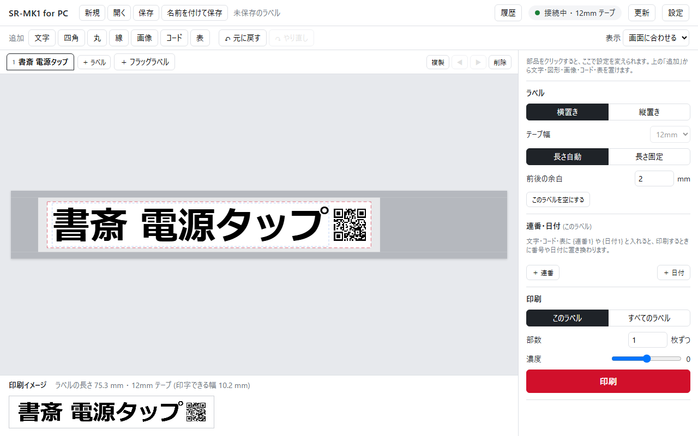
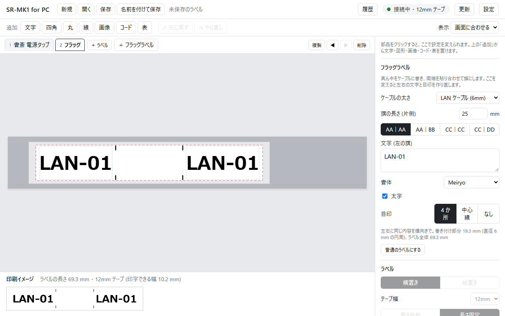
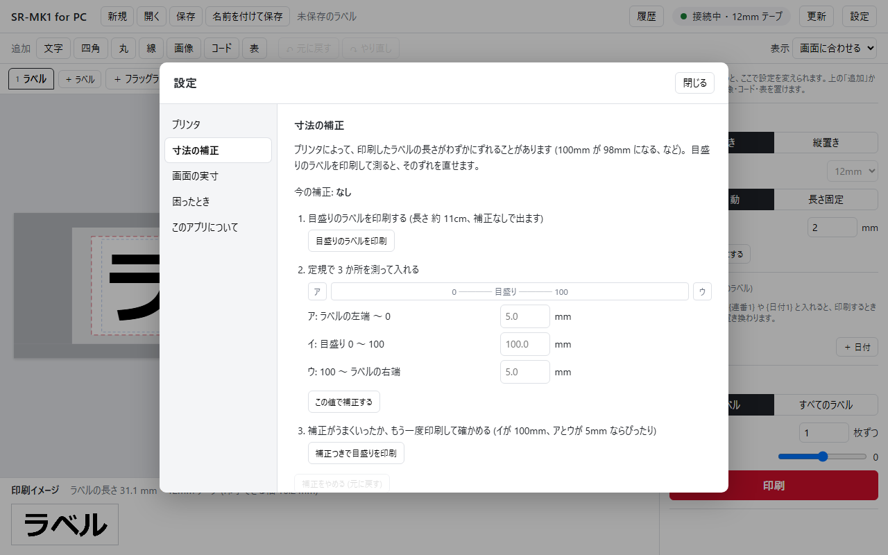

# 使い方

[← README に戻る](../README.md)

- [画面の見かた](#画面の見かた)
- [部品を置く・動かす](#部品を置く動かす)
- [文字](#文字) ／ [図形・画像](#図形画像) ／ [QR コード・バーコード](#qr-コードバーコード) ／ [表](#表)
- [ラベルの設定（向き・長さ・余白）](#ラベルの設定)
- [複数のラベル](#複数のラベル)
- [連番・日付](#連番日付)
- [フラッグラベル（ケーブル用）](#フラッグラベル)
- [印刷](#印刷)
- [保存・開く・印刷履歴](#保存開く印刷履歴)
- [寸法の補正](#寸法の補正) ／ [画面の実寸](#画面の実寸)
- [キーボード操作](#キーボード操作)

---

## 画面の見かた

| 場所 | 内容 |
|---|---|
| 上の段 | ファイル（新規・開く・保存）、印刷履歴、**プリンタの状態**、設定 |
| 2 段目 | 部品の追加（文字・四角・丸・線・画像・コード・表）、元に戻す、表示の大きさ |
| 真ん中 | ラベルの編集。灰色の帯がテープ、白いところが印字できる範囲です |
| 下 | **印刷イメージ**。実際に印刷される白黒の姿です |
| 右 | 選んだ部品の設定、ラベル全体の設定、連番・日付、印刷 |

右上のプリンタの状態は、4 秒ごとに自動で更新されます。

| 表示 | 意味 |
|---|---|
| 🟢 接続中 ・ 12mm テープ | 印刷できます。テープの幅はプリンタから自動で読み取ります |
| ⚪ 未接続 | プリンタにつながっていません。押すと理由が表示されます |
| 🔴 （エラーの内容） | カバーが開いている、テープがないなど。表示のとおりに直してください |

> [!TIP]
> 作りかけのラベルは自動で残ります。アプリを閉じても、次に開いたときに続きから作れます。

## 部品を置く・動かす

2 段目の「追加」のボタンで、ラベルに部品を置きます。

- **動かす**: ドラッグ。キーボードの矢印キーでも動かせます（0.25mm ずつ、Shift を押しながらだと 2mm ずつ）
- **大きさを変える**: 部品のまわりの四角いつまみをドラッグ
- **いくつか選ぶ**: Shift を押しながらクリック、または何もないところからドラッグして囲む

部品を選ぶと、右の欄に次のボタンが出ます。

- 複製、削除、90 度回転、ロック（動かないようにする）、左右反転、上下反転
- グループ（いくつかの部品をひとまとめに）、グループ解除
- 重なりの順番（最前面・前面・背面・最背面）
- **揃え**: 1 つ選んでいるときはラベルに対して、いくつか選んでいるときは部品どうしで、左・中央・右・上・中央・下に揃えます

## 文字

- 文字はダブルクリックするか、右の欄の入力欄で変えます。改行すると複数行になります
- **書体**: パソコンに入っている書体から選べます
- **サイズ自動**: オンにすると、枠いっぱいの大きさに自動で合わせます。オフにすると pt で指定できます
- **スタイル**: 太字、斜体、下線、取り消し線、二重取り消し線
- **揃え**: 左・中央・右・均等
- **装飾**: 縁強調、白抜き、縁取り、淡文字
- **縦書き**
- **枠を文字に合わせる**: オンにすると、文字の長さに合わせて枠が伸び縮みします。オフにすると枠の長さが固定になります
- **記号・絵文字**: 「記号・絵文字」を開くと、★ ① ℃ ⚠ などを入れられます

## 図形・画像

- **四角・丸・線**: 線の太さ（mm）、実線・破線・点線、塗りつぶし、四角の角の丸み
- **画像**: パソコンの画像ファイル（PNG、JPG など）を白黒にして置きます。
  イラストやロゴは「しきい値」（濃さを調整）、写真は「網点」がきれいに出ます

## QR コード・バーコード

「コード」で QR コードを置き、右の欄で種類と内容を変えます。

使える種類: QR コード、CODE128、CODE39、JAN-13、JAN-8、UPC-A、UPC-E、NW-7、ITF、GS1-128、
GS1 データバー（7 種類）、カスタマバーコード（郵便）

- **太さ**: バーやマスの 1 本の幅（ドット）。大きくすると読み取りやすくなりますが、長くなります
- **高さ**（バーコードのみ）、**数字を表示**（バーコードのみ）
- 内容がその種類に合わないとき（JAN に文字を入れたなど）は、赤字でお知らせします

> [!IMPORTANT]
> 印刷したら、バーコードリーダーやスマホで読み取れるか必ず確かめてください。
> 細いテープ（12mm 以下）に長い内容を入れると、読み取りにくくなることがあります。

## 表

行と列の数、罫線の太さ、書体、太字を選べます。各マスの文字は右の欄で入力します。

## ラベルの設定

部品を何も選んでいないときも、右の欄の「ラベル」で全体の設定を変えられます。

- **横置き／縦置き**: 横置きは横に長いラベル、縦置きはテープを縦にして読むラベルです
- **テープ幅**: プリンタにつながっているときは自動です（変えられません）。つながっていないときは手で選べます
- **長さ自動／長さ固定**: 自動は部品に合わせて長さが決まります。固定は 10〜3000mm で指定します
- **前後の余白**: ラベルの両端の余白（mm）。端に線を引くときは 2mm 以上にすると、カットで切れません

## 複数のラベル

ラベルの上のタブで、1 つのファイルに複数のラベルを作れます。

- **＋ ラベル**: 新しいラベルを追加
- **複製**: 今のラベルをコピー
- **◀ ▶**: 順番を入れ替え
- **削除**: 今のラベルを削除

印刷の欄で「すべてのラベル」を選ぶと、全部のラベルをまとめて印刷します（1 枚ずつカットされます）。

## 連番・日付

文字・コードの内容・表のマスに `{連番1}` や `{日付1}` と書くと、印刷するときに番号や日付に置き換わります。

1. 右の欄の「連番・日付」で **「＋ 連番」** を押す（`{連番1}` ができます）
2. 文字の欄の下に出る **「差し込み: {連番1}」** を押すと、カーソルの位置に入ります
3. 印刷の欄の「部数」を 10 にして印刷すると、`001`〜`010` の 10 枚が出ます

連番の設定:

| 項目 | 内容 |
|---|---|
| 種類 | 数字、アルファベット（A, B, … Z, AA）、リスト（自分で書いた言葉を順番に） |
| 初期値・増分 | 例: 初期値 100、増分 5 → 100, 105, 110 … 。増分はマイナスや小数（0.5 など）も使えます |
| 繰り返し | 同じ番号を何枚ずつ出すか |
| 最大値 | ここまで行ったら初期値に戻ります |
| 桁数・0 で埋める・3 桁区切り | `007` や `1,000` のような表し方 |
| 印刷したら続きの番号にする | オンにすると、次に印刷するとき続きの番号から始まります |

日付の書式: `2026/11/15`、`2026年11月15日`、`令和8年11月15日`、`R8.11.15`、`11/15`、`14:30` など。
「日をずらす」で、30 日後の日付（賞味期限など）も入れられます。

> [!TIP]
> 部数の下に「{連番1}: 001 〜 010」のように、印刷される番号の範囲が表示されます。

## フラッグラベル

ケーブルに巻き付けて、旗のように貼り合わせるラベルです。LAN ケーブルや電源コードの見分けに使えます。

1. タブの右の **「＋ フラッグラベル」** を押す
2. 右の欄で **ケーブルの太さ**（LAN ケーブル 6mm など。直径を mm で入れることもできます）と **旗の長さ** を選ぶ
3. 文字を入れる。**レイアウト**で左右を同じ文字にするか（AA｜AA）、別々の文字にするか（AA｜BB）、縦書きにするか（CC）を選べます
4. 印刷して、真ん中の部分をケーブルに 1 周巻き付け、両端の旗の裏どうしを貼り合わせる

**目印**（4 か所／中心線）は、巻き付ける部分の位置を示す線です。巻き付け部分の長さは「直径 × 3.14 + 0.5mm」で自動で決まります。
自由に編集したいときは「普通のラベルにする」を押します。

## 印刷

右の欄の一番下で設定して、**「印刷」**（または Ctrl+P）を押します。

- **このラベル／すべてのラベル**: 印刷するラベル
- **部数**: 1 つのラベルを何枚ずつ印刷するか
- **濃度**: −5（薄い）〜 +5（濃い）

印刷中は、何枚目を印刷しているかが表示されます。**1 枚ずつ印刷が終わるのを待ってから次へ進む**ので、
途中で止まっても、どこまで出たか分かります。

- **中止**: 今のラベルを印刷し終わったところで止めます
- **続きから印刷**: テープ切れやカバーの開きで止まったときは、直してからこのボタンを押すと、止まったラベルから印刷し直します

## 保存・開く・印刷履歴

- **保存**（Ctrl+S）／**名前を付けて保存**／**開く**（Ctrl+O）: ラベルを `.json` のファイルに保存します。
  タブで作った複数のラベル、連番・日付の設定もまとめて保存されます
- **新規**: 新しいファイルを始めます
- **履歴**: 最近の 50 回分の印刷が残っています
  - **もう一度印刷**: 前回とまったく同じ内容で印刷します（連番も同じ番号）
  - **ラベルに追加**: そのときのラベルを読み込んで、編集できます

## 寸法の補正

プリンタによって、印刷したラベルの長さがわずかにずれることがあります（100mm が 98mm になる、など）。
次の手順で直せます。一度合わせれば、そのあとの印刷すべてに使われます。

1. 「設定」→「寸法の補正」→ **「目盛りのラベルを印刷」**（長さ約 11cm のラベルが出ます）
2. 定規で 3 か所を測って入れる
   - **ア**: ラベルの左端 〜 目盛りの 0
   - **イ**: 目盛りの 0 〜 100
   - **ウ**: 目盛りの 100 〜 ラベルの右端
3. **「この値で補正する」** を押す
4. **「補正つきで目盛りを印刷」** で確かめる（イが 100mm、アとウが 5mm ならぴったり）

元に戻すときは「補正をやめる」を押します。

## 画面の実寸

「表示: 実寸」にしたとき、画面の大きさが本物と同じになるように合わせます。
「設定」→「画面の実寸」で、画面のバーを定規で測って入れてください。

## キーボード操作

| キー | 操作 |
|---|---|
| Ctrl+P | 印刷 |
| Ctrl+S ／ Ctrl+Shift+S | 保存 ／ 名前を付けて保存 |
| Ctrl+O | 開く |
| Ctrl+Z ／ Ctrl+Y | 元に戻す ／ やり直し |
| Ctrl+C ／ Ctrl+V ／ Ctrl+D | コピー ／ 貼り付け ／ 複製 |
| Ctrl+G ／ Ctrl+Shift+G | グループ ／ グループ解除 |
| Delete | 削除 |
| 矢印キー（Shift） | 0.25mm ずつ（2mm ずつ）動かす |
| T | 文字を追加 |
